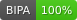

# CLDF dataset derived from Hooley's "Austronesian languages of the Morobe District, Papua New Guinea" from 1971

## How to cite

If you use these data please cite
- the original source
  > Hooley, Bruce A. 1971. Austronesian languages of the Morobe District, Papua New Guinea. Oceanic Linguistics 10(2): 79-151. DOI: 10.2307/3622783
- the derived dataset using the DOI of the [particular released version](../../releases/) you were using

## Description

This dataset is licensed under a CC-BY-4.0 license

Available online at https://doi.org/10.2307/3622783

## Notes

The data were transcribed from the comparative tables (pp. 109–151) of Hooley (1971): 55 varieties × 128 concepts, with Hooley's cognate-set numbers. Cognate sets are numbered per concept, so `Cognateset_ID` is `<concept>-<number>`. Cells printed as "—" are omitted.

### Editorial cognate decisions
Three forms are printed without a cognate number. The editor assigned them as follows:

| Variety | Concept | Form | Set | Basis |
| --- | --- | --- | --- | --- |
| Dambi | knee | ƀaγa katu | 2 | Piu `ƀaγa kato` 2, Buasi `ƀaγam 'ka.ndu` 2, Latep `ƀʌǥʌkʌtu` 2 |
| Wampur | pig | gihap | 8 | Sirasira `giap` 8, Mari `gihʌp` 8 |
| Maralango | liver | lage'fua | 12 | new set; 12 is unused in Hooley's numbering for 'liver' |

All other cognate numbers are as printed.

### Extraction confidence
`FormTable.Extraction_Confidence` records how each form was verified against the scan:

- `HIGH`: letters and cognate number agree with an independent OCR pass, and the form has no diacritics that OCR cannot verify.
- `MED`: contains marks checked by eye only (dots, plus signs, hooks, carons, tildes, ties, superscripts, barred letters).
- `MANUAL`: checked by an editor against the 600 dpi scan.

Barred g (ǥ) is distinct from γ in the print and is kept distinct here. Small capitals in the print are full capitals (Ɔ, U, H, R) and are kept as printed.

### Segments
Hooley gives no IPA values in the tables. The orthography profile (`etc/orthography.tsv`) maps his symbols to BIPA. Mappings marked `UNCERTAIN` in its `Comment` column are informed guesses (52 of 146 graphemes). The most consequential are:

- ǥ → ʁ: a placeholder that keeps its contrast with γ (→ ɣ) in 11 varieties.
- ř and r̃ → r (trill), plain r → ɾ. ř and r̃ never co-occur in a variety.
- ɏ → ʝ; dot below → backed (ḳ q, g̣ ɢ, ŋ̣ ɴ, ṭ ʈ, ạ ɑ).
- Capital vowels → voiceless.
- `.` → length on the preceding segment; superscript stops → unreleased.
- Accents, ties and double macrons are dropped.

Use the `Form` column for Hooley's original transcription.

## Statistics

- **Varieties:** 55 (linked to 48 different Glottocodes)
- **Concepts:** 128 (linked to 128 different Concepticon concept sets)
- **Lexemes:** 6,716
- **Sources:** 1
- **Synonymy:** 1.00
- **Cognacy:** 6,716 cognates in 2,328 cognate sets (1,368 singletons)
- **Cognate Diversity:** 0.33
- **Invalid lexemes:** 0
- **Tokens:** 34,805
- **Segments:** 113 (0 BIPA errors, 0 CLTS sound class errors, 113 CLTS modified)
- **Inventory size (avg):** 33.53

# Contributors

Name | GitHub user | Description | Role
--- | --- | --- | ---
Bruce A. Hooley | | data collector | Author
SimonGreenhill | | extraction, CLDF conversion | Editor

## CLDF Datasets

The following CLDF datasets are available in [cldf](cldf):

- CLDF [Wordlist](https://github.com/cldf/cldf/tree/master/modules/Wordlist) at [cldf/cldf-metadata.json](cldf/cldf-metadata.json)